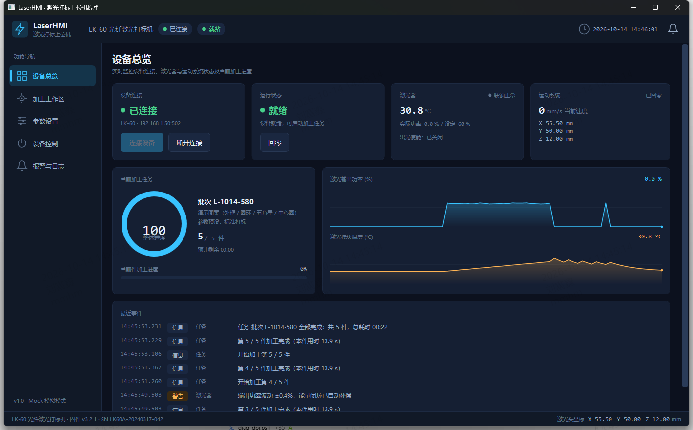
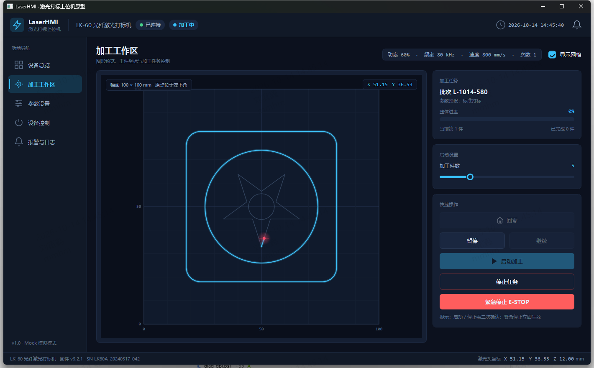
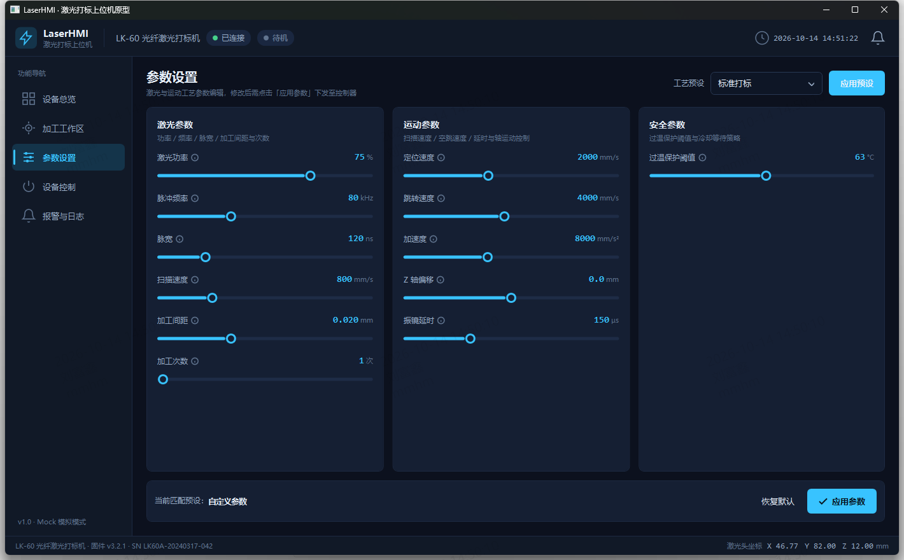
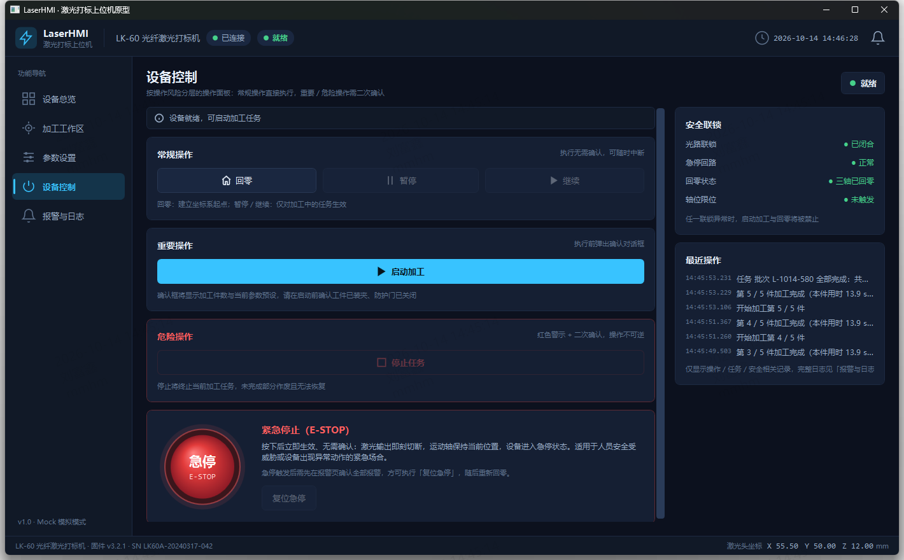
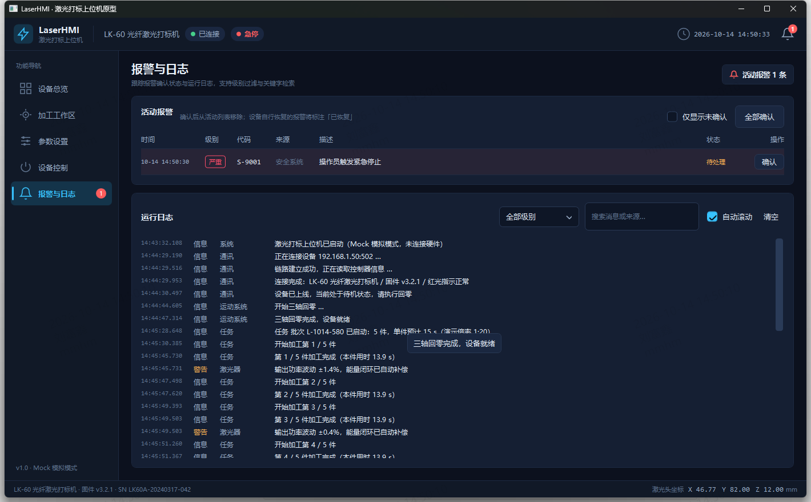
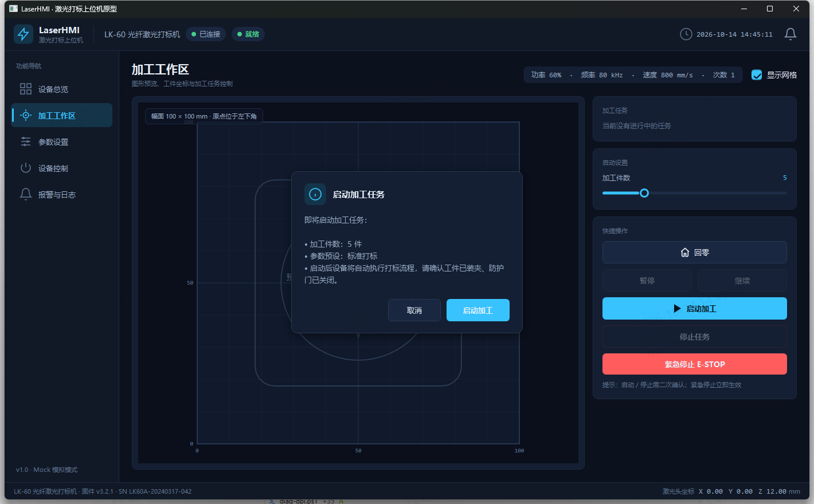
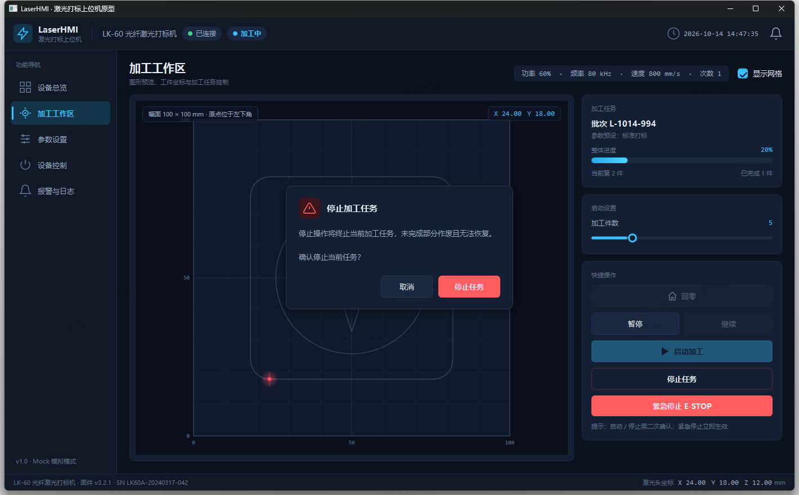

# LaserHmi · 激光打标上位机 HMI 原型

> 面向光纤激光打标设备的 WPF 上位机人机界面（HMI）原型，采用 C# + WPF + MVVM 实现，内置 Mock 设备服务，可在无真实硬件环境下完整演示"连接 → 回零 → 参数配置 → 加工 → 报警处理"全流程。



## 项目简介

本原型以"光纤激光打标机"为模拟对象，聚焦上位机软件的核心职责：**设备状态可视化、加工任务控制、工艺参数管理、报警与日志追溯**。界面采用深色工业风设计，操作按风险等级分层（普通操作直接执行、重要操作确认对话框、危险操作红色二次确认、紧急停止立即生效），并围绕操作后反馈（状态徽章、实时日志、联锁指示、报警确认）构建完整的操作闭环。

| 页面 | 说明 |
| --- | --- |
| 设备总览 | 设备状态徽章、加工进度环、功率/温度实时曲线、关键指标卡 |
| 加工工作区 | 加工图形预览与路径进度动画、激光头坐标、任务信息、启动设置、快捷操作 |
| 参数设置 | 激光参数（功率/频率/脉宽/扫描速度/加工间距/次数）、运动参数、安全参数、工艺预设 |
| 设备控制 | 按风险分层的操作面板（常规/重要/危险/紧急）、安全联锁指示、最近操作记录 |
| 报警与日志 | 活动报警列表（分级/确认）、运行日志流（级别过滤/搜索/自动滚动） |

## 功能演示

| 加工工作区（加工中） | 参数设置 |
| --- | --- |
|  |  |

| 设备控制（风险分层） | 报警与日志 |
| --- | --- |
|  |  |

| 重要操作确认（蓝色） | 危险操作确认（红色） |
| --- | --- |
|  |  |

## 开发环境

- **操作系统**：Windows 10 1809+ / Windows 11（暗色标题栏依赖 DWM 属性，低于 1809 自动降级）
- **.NET SDK**：10.0（项目目标框架 `net10.0-windows`；满足试题 ".NET 6/8+" 要求）
- **IDE**：Visual Studio 2022+ / Rider / VS Code（可选）
- 无需任何外部设备或第三方软件，纯 Mock 运行

## 技术栈

- **UI 框架**：WPF（Windows Presentation Foundation）
- **语言**：C# 13（`nullable` 启用、文件范围命名空间）
- **MVVM**：[CommunityToolkit.Mvvm 8.4.2](https://learn.microsoft.com/dotnet/communitytoolkit/mvvm/)（`[ObservableProperty]` / `[RelayCommand]` 源生成器）
- **依赖注入**：手工组合根（`App.xaml.cs`），接口与服务一对一注册，无容器依赖
- **自绘控件**：`MarkingPreview`（加工路径预览 + 弧长进度点亮）、`Sparkline`（实时曲线）、`ProgressRing`（环形进度），均基于 `DrawingContext` 直接绘制
- **主题资源**：`Themes/` 下四份资源字典（调色板/图标几何/控件样式/输入控件样式），全局深色工业风

## 运行方式

```powershell
# 1. 还原并构建
dotnet build LaserHmi.slnx

# 2. 运行（Mock 模式，无需硬件）
dotnet run --project src/LaserHmi.App
```

首次启动即进入"设备总览"页，按以下流程体验完整闭环：

1. 点击右上角 **连接设备** → 等待约 2 秒，状态徽章变为「待机」
2. 进入 **加工工作区**，点击 **回零** → 三轴回零完成后变为「就绪」
3. 点击 **启动加工** → 弹出蓝色确认对话框 → 确认后观察图形轨迹逐步点亮、激光头移动、坐标实时刷新
4. 加工中可 **暂停 / 继续**；**停止任务** 将弹出红色危险确认框；**紧急停止 E-STOP** 立即生效
5. 进入 **报警与日志** 查看分级日志；触发急停后可在此确认报警，再回到设备控制页 **复位急停**

> 演示倍率：Mock 服务按 1:20 加速（单件加工约 4.4 秒），便于快速观察完整流程。

## 目录结构

```
LaserHmi/
├─ LaserHmi.slnx                   # 解决方案（新版 XML 格式）
├─ docs/
│  ├─ design.md                    # 调研与设计文档（调研分析/信息架构/交互设计/WPF 架构/后续规划）
│  └─ images/                      # 文档与 README 配图（运行截图）
├─ tools/
│  └─ ui-verification/             # 开发期 UI 自动化验证脚本（UIA 驱动，见下节）
└─ src/LaserHmi.App/
   ├─ App.xaml(.cs)                # 应用入口 + 组合根（服务注册）
   ├─ MainWindow.xaml(.cs)         # 主窗口：顶部状态栏 + 侧边导航 + 页面宿主
   ├─ Models/                      # 领域模型（状态/参数/任务/报警/日志/路径）
   ├─ Services/                    # 服务接口与实现（设备/Mock 状态机、日志、参数、对话框）
   ├─ ViewModels/                  # 各页面 ViewModel（MVVM，零逻辑代码隐藏）
   ├─ Views/                       # 各页面视图（纯声明式 XAML）
   ├─ Controls/                    # 自绘控件（MarkingPreview/Sparkline/ProgressRing）
   ├─ Converters/                  # 值转换器（状态→文本/颜色/可见性等）
   ├─ Themes/                      # 深色工业风主题资源字典
   └─ Dialogs/                     # 操作确认对话框（信息级/危险级）
```

## 操作分级设计

| 级别 | 操作示例 | 交互策略 | 视觉语言 |
| --- | --- | --- | --- |
| 普通 | 回零、暂停、继续、连接/断开 | 直接执行，无确认 | 次级按钮（描边） |
| 重要 | 启动加工、应用参数 | 蓝色信息确认对话框 | 主色实心按钮 |
| 危险 | 停止任务（终止未完成部分不可恢复） | 红色警告确认对话框 + 红色实心确认按钮 | 危险色系 |
| 紧急 | 紧急停止 E-STOP | 立即生效、无需确认 | 独立大圆钮 + 光环，始终可达 |

## 开发期验证（tools/ui-verification）

原型开发过程中使用 Windows UI Automation（UIA）编写了脚本化验证流程，自动驱动应用完成"连接 → 回零 → 启动 → 暂停/继续 → 停止 → 急停 → 报警确认 → 复位"全链路并截图比对，用于回归验证核心交互与状态机流转。

```powershell
# 示例：完整交互流程验证（需应用已启动）
powershell -File tools/ui-verification/verify-estop.ps1
```

## 文档

- 调研与设计文档：[docs/design.md](docs/design.md)（调研分析、信息架构、交互与视觉设计思路、WPF 技术架构、未完成内容与后续优化）
