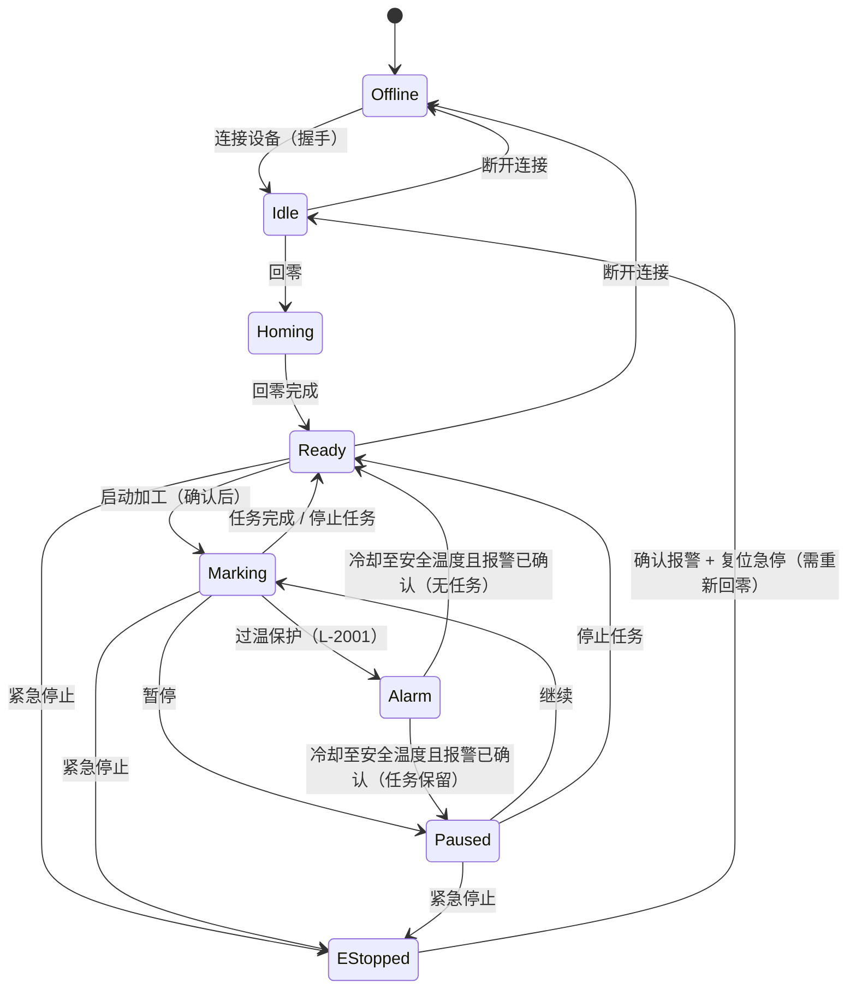
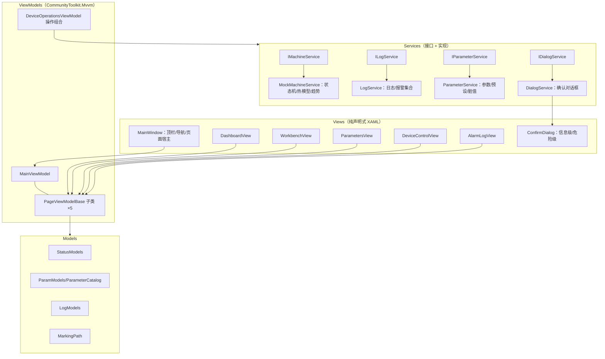

# LaserHmi 调研与设计文档

> 本文档记录激光打标上位机 HMI 原型的调研过程、信息架构、交互与视觉设计思路、WPF 技术架构，以及未完成内容与后续优化方向。

## 1. 项目背景与目标

### 1.1 背景

激光打标是工业制造中广泛应用的精密加工工艺，光纤激光打标机因免维护、寿命长、光束质量高，被大量用于 3C 电子、五金工具、医疗器械、汽车零部件的二维码/序列号/Logo 打标。一套完整的打标系统由**激光器、振镜（Galvo）、场镜、运动轴、控制器与上位机软件**组成。

上位机软件承担着"人对设备"的全部接口职责：设备状态是否健康、当前任务进度如何、参数是否正确、出现异常怎么处理。它直接决定了操作员的效率与误操作风险，因此在工业场景中对**信息清晰度、操作安全性与可追溯性**有远高于普通软件的要求。

### 1.2 目标

用 C# + WPF 实现一套激光打标上位机 HMI 原型，覆盖试题要求的五大功能域：

1. 主界面与设备状态总览
2. 加工工作区（图形预览 / 坐标区域 / 加工操作 / 任务信息）
3. 参数设置（激光参数、运动参数）
4. 设备控制（回零、启动、暂停/继续、停止，体现操作分级）
5. 报警与日志

约束：MVVM 架构、Mock 数据可运行、避免逻辑集中于 Code Behind。

## 2. 调研分析

### 2.1 行业软件形态调研

**（1）设备配套控制软件：以 EZCAD（金橙子）为代表**

EZCAD 是国内外激光打标行业使用最广泛的控制软件，支持光纤/CO₂/紫外等多种激光器，其功能形态代表了行业事实标准：

- **图形编辑为核心**：矢量对象绘制、轮廓/填充方案（填充线间距、角度）、图层管理
- **激光参数体系**：功率（%）、频率（kHz）、打标速度（mm/s）、脉宽（ns）、加工次数、延时参数（振镜延时、跳转延时）
- **红光指示与定位**：红光预览打标范围、坐标定位
- **批量生产能力**：变量文本（流水号、日期、批次号）、数据源导入、序列化打标
- **外设扩展**：旋转轴、飞行打标（在线打标）

EZCAD 的定位是**面向打标工艺工程师**的"设备端控制 + 图形编辑"软件，功能深但界面密集、学习曲线陡。

**（2）产线级上位机 / HMI：以工业组态与 SCADA 实践为代表**

产线场景中，打标工位通常还配有面向**操作员**的上位机软件（或 MES 终端），职责与 EZCAD 形成互补：

- **状态监控**：设备运行状态、关键指标（功率、温度、速度）实时曲线
- **任务管理**：生产任务下发、进度跟踪、批次追溯
- **安全操作**：按风险分级的操作确认（启动/停止），急停等安全回路
- **报警管理**：报警分级、确认（Acknowledge）、恢复追踪——参考 ISA-18.2 报警管理理念
- **可追溯性**：运行日志、操作记录、报警历史

**（3）通用工业 HMI 设计规范实践**

- ISA-101（HMI 设计标准）主张**常态界面保持低饱和度、克制用色**，仅异常状态使用高亮色彩，避免"警报疲劳"
- 操作按风险分层：常规操作即时响应；影响生产或不可逆的操作必须二次确认；安全相关操作（E-Stop）独立于软件逻辑、立即生效

### 2.2 调研结论 → 设计决策

| 调研发现 | 本原型的设计决策 |
| --- | --- |
| EZCAD 面向工程师、信息密度极高 | 本原型定位**面向产线操作员**的监控/操作型 HMI，信息分层、单页聚焦 |
| 图形编辑是 EZCAD 核心，但原型的重点在"加工执行与监控" | 工作区不实现矢量编辑器，而是**图形预览 + 加工路径进度动画 + 坐标显示**，聚焦加工执行过程可视化 |
| 激光参数体系庞大（十余类） | 提取**高频工艺参数**（功率/频率/脉宽/扫描速度/间距/次数）+ 运动参数 + 安全参数，配"工艺预设"降低操作门槛 |
| 工业现场 7×24 运行、注视时间长 | **深色工业风**（低亮度背景降低视觉疲劳），强调色仅用于状态与操作语义 |
| 误操作代价高（材料报废、设备损伤） | **操作分级模型**：普通/重要/危险/紧急四级，与视觉层级一一对应 |
| 报警需要闭环（产生→确认→恢复） | 报警具备**分级、待处理/已恢复/已确认状态流转**，活动报警在全局导航与顶栏可见 |
| 运行过程需要可追溯 | 全量**运行日志**（时间/级别/来源/消息）+ 级别过滤 + 搜索 + 自动滚动 |

## 3. 信息架构

### 3.1 导航结构

顶部状态栏（全局）+ 左侧固定导航（5 项）+ 内容区（单页聚焦）。全局层常驻信息：设备型号、连接状态、设备状态徽章、系统时钟、报警铃（带未确认计数）。将"连接/断开设备"收敛到顶部状态栏，因为它是与页面无关的全局会话操作。

```
┌─────────────────────────────────────────────────────────┐
│ 顶部状态栏  品牌 | 设备型号 | ●连接状态 | ●设备状态 | 时钟 | 🔔报警 │
├──────────┬──────────────────────────────────────────────┤
│ 侧边导航  │  内容区（按导航切换的页面）                     │
│ 设备总览  │                                              │
│ 加工工作区│                                              │
│ 参数设置  │                                              │
│ 设备控制  │                                              │
│ 报警与日志│                                              │
├──────────┴──────────────────────────────────────────────┤
│ 底部信息条  设备/固件/SN                      激光头坐标 X/Y/Z │
└─────────────────────────────────────────────────────────┘
```

### 3.2 页面信息要素

| 页面 | 核心信息要素 | 主要操作 |
| --- | --- | --- |
| 设备总览 | 设备状态徽章、当前任务与进度环、剩余时间、激光功率/频率、模块温度、功率与温度实时曲线、联锁/回零状态卡 | 跳转工作区、跳转报警页 |
| 加工工作区 | 幅面 100×100mm 图形预览（网格/坐标轴）、加工路径点亮、激光头实时位置、任务进度与件数、参数摘要（只读） | 回零、启动加工（确认）、暂停、继续、停止（危险确认）、设置件数、显示网格开关 |
| 参数设置 | 激光参数组（功率/频率/脉宽/扫描速度/加工间距/次数）、运动参数组（定位速度/跳转速度/加速度/Z 轴偏移/振镜延时）、安全参数（过温阈值）、参数说明 ToolTip | 滑块调参、应用参数（确认）、恢复默认、工艺预设下拉、应用预设、脏数据提示 |
| 设备控制 | 按风险分组的操作面板、安全联锁 4 项（光路/急停回路/回零/限位）、最近操作记录、急停大圆钮 | 回零、暂停、继续、启动加工、停止任务、紧急停止、复位急停、连接/断开 |
| 报警与日志 | 活动报警表（时间/级别/代码/来源/描述/状态）、报警确认、日志流（级别过滤/搜索/自动滚动/清空） | 确认单条、全部确认、过滤、清空日志 |

## 4. 交互与视觉设计

### 4.1 操作分级模型

| 级别 | 操作 | 交互策略 | 视觉语言 |
| --- | --- | --- | --- |
| 普通 | 回零、暂停、继续、连接/断开 | 直接执行；按钮可用性由状态机驱动 | 次级按钮：深底 + 细描边 |
| 重要 | 启动加工、应用参数 | 蓝色信息确认对话框（展示关键上下文：件数、参数摘要、安全提示） | 主题色实心按钮 |
| 危险 | 停止任务 | 红色警告对话框 + 红色实心确认按钮 + "不可恢复"文案 | 危险色系、警示图标 |
| 紧急 | 紧急停止（E-STOP） | 立即生效、无需确认；触发后产生 S-9001 严重报警 | 独立大圆钮（无边框卡片内），光环强化，始终可达 |

配合规则：**按钮可用性 = 状态机允许 ∧ 前置条件满足**。例如未回零时"启动加工"禁用；急停未确认报警时"复位急停"禁用；急停后必须重新回零才能加工。所有被拒绝的操作都会写入日志（如"断开连接被拒绝：请先停止加工"），保证可追溯。

### 4.2 状态机驱动 UI

设备主状态机（Mock 服务实现，UI 完全由状态驱动，无页面自行维护的布尔标志）：



状态 → UI 的映射集中在转换器层（`MachineStateToTextConverter`、`MachineStateToBrushConverter`、`MachineStateToHintConverter` 等），页面不重复维护状态文案，保证全局一致性。

### 4.3 色彩语义系统

以深色工业风为基调：低亮度背景降低长时间注视疲劳，高对比强调色承载操作与状态语义。

| 色值 | 语义 | 用途 |
| --- | --- | --- |
| `#0C111E` | 基底 | 窗口背景 |
| `#151F33` | 卡片 | 面板/卡片容器 |
| `#38C3FF`（青蓝） | 主强调 | 品牌、可操作的主路径、信息级确认 |
| `#46D08A`（绿） | 正常/成功 | 就绪、已连接、联锁正常、完成 |
| `#FFB454`（橙） | 警告 | 已暂停、待处理报警、功率波动提示 |
| `#FF5D5D`（红） | 危险/故障 | 急停、严重报警、危险操作按钮、停止 |

状态徽章（顶栏）：离线（灰）/ 待机（蓝灰）/ 就绪（绿）/ 加工中（青蓝，呼吸感）/ 已暂停（橙）/ 报警（红）/ 急停（红），颜色与文案始终成对出现，不使用颜色单独表意（色觉障碍兼容）。

### 4.4 反馈机制：操作闭环

每次操作都提供**多层即时反馈**，形成"操作 → 执行 → 结果"的闭环：

1. **控件层**：按钮按下/悬停/禁用态；命令 `CanExecute` 与状态机实时联动
2. **状态层**：顶栏徽章、侧边导航项、总览页卡片同步变化
3. **过程层**：加工路径逐段点亮 + 激光头移动 + 坐标实时刷新 + 进度环/进度条
4. **记录层**：每一步写入运行日志（含来源分类），报警拥有独立生命周期（待处理 → 已恢复 → 已确认），活动报警数在顶栏报警铃与导航项上可见

## 5. WPF 技术架构

### 5.1 分层结构



- **Views**：页面内零业务逻辑；唯一的代码隐藏是 `AlarmLogView.xaml.cs` 的"日志自动滚动"（订阅集合变化后 `ScrollToEnd`），属于纯视图行为
- **ViewModels**：命令 + 可绑定属性；业务规则放在服务层，VM 只做编排与状态暴露
- **Models**：可观察的领域模型（`MachineStatus` 等实现 `INotifyPropertyChanged`），状态变化直接驱动 UI
- **Services**：四个接口面向接口编程，Mock 实现与 UI 解耦（替换真实通讯实现时 UI 零改动）

### 5.2 MVVM 实现要点

- **导航**：`MainViewModel.Pages` 为页面 VM 列表，`SelectedPage` 驱动 ContentControl；`DataTemplate` 将各 VM 映射到对应 View（`ViewModel-first` 导航，无页面实例化代码）
- **命令**：`[RelayCommand(CanExecute=...)]` 源生成器；操作可用性集中在 `DeviceOperationsViewModel`，被工作区/控制页共用，避免重复实现
- **组合根**：`App.xaml.cs` 手工构造服务与 VM 并注入 MainWindow（无 DI 容器依赖，依赖关系显式可读）

### 5.3 Mock 服务设计

`MockMachineService` 以 100ms `DispatcherTimer` 驱动：

- 一套完整状态机（对应 4.2 节流程图）+ 连接握手/回零的**缓动动画**（带中间过程，不是瞬时跳变）
- **激光与热模型**：出光升温（与功率相关）、每件完成后温升台阶、停机指数回落、超阈值触发 L-2001 过温报警并自动挂起任务、冷却至安全温度后自动恢复
- **任务模型**：件数、单件进度、总进度、剩余时间、激光头坐标沿 `MarkingPath` 弧长插值推进
- **趋势数据**：功率/温度环形缓冲（72 点），供 Sparkline 绘制
- 演示倍率 1:20，单件约 4.4 秒，完整观测加工与温升过程

### 5.4 自绘控件

| 控件 | 实现 | 说明 |
| --- | --- | --- |
| `MarkingPreview` | `FrameworkElement` + `OnRender` | 绘制幅面网格、坐标刻度、图形轮廓；按进度以"已加工色"重绘路径前缀，端点绘制激光头（辉光效果），当前段高亮 |
| `Sparkline` | `FrameworkElement` + `OnRender` | 环形缓冲数据的折线 + 渐变填充 + 最新值端点 |
| `ProgressRing` | `FrameworkElement` + `OnRender` | 环形进度（弧长）+ 中心百分比文本 |

选择自绘而非第三方图表库：原型场景下数据简单、需要完全匹配主题配色，自绘可保证视觉一致且零依赖。

### 5.5 主题资源系统

`Themes/` 四份资源字典按职责拆分：

- `Palette.xaml`：全部颜色画刷/语义颜色（唯一色彩来源）
- `Icons.xaml`：Path Geometry 图标库（矢量、可换色）
- `Controls.xaml`：按钮族（主/次/危险/危险实心/急停）、卡片、徽章、表头、滚动条等
- `Inputs.xaml`：Slider、ComboBox、TextBox、CheckBox、ListBox（导航项）模板

样式重写遵循"控件语义命名"（如 `DangerSolidButton`），页面只引用语义样式，不写内联视觉细节。

## 6. 验证与质量保障

原型开发完成后，使用 **Windows UI Automation（UIA）脚本**驱动应用完成全流程回归验证（脚本位于 `tools/ui-verification/`），覆盖：

| 验证场景 | 关键断言 | 结果 |
| --- | --- | --- |
| 连接 → 回零 | 徽章"待机→就绪"、日志完整（握手/固件/回零完成） | 通过 |
| 启动加工（重要操作） | 蓝色确认框展示件数/预设/安全提示 | 通过 |
| 加工过程 | 路径逐段点亮、激光头移动、坐标刷新、按钮联动 | 通过 |
| 暂停/继续 | 橙色"已暂停"徽章、轨迹停留、继续按钮可用 | 通过 |
| 任务完成 | 进度 100%、批次汇总日志、温度曲线回落 | 通过 |
| 停止任务（危险操作） | 红色确认框；确认后任务清空、回到就绪、日志"已被停止" | 通过 |
| 急停全流程 | 急停徽章、S-9001 报警、联锁"已触发"、复位按钮受控禁用 → 确认报警 → 复位后"未回零" | 通过 |
| 参数应用 | 滑块调值 → 脏提示 → 应用后"自定义参数"识别与日志 | 通过 |

验证过程同时产出了**可访问性改进**（为图标+文字复合按钮补充 UIA 名称/AutomationId），使界面可被自动化测试工具与辅助技术识别。

开发中通过截图验证发现并修复的典型问题：

1. **`StringFormat` 三段式对 `bool` 无效**（显示 True/False）→ 新增 `BoolToTextConverter` 并全局替换
2. **白色标题栏与暗色界面割裂** → `DwmSetWindowAttribute(20)` 启用暗色标题栏（低版本系统自动降级）
3. **自定义 ComboBox 模板下 `DisplayMemberPath` 失效**（显示类型名）→ 改用 `ItemTemplate`
4. **空态浮层残留**（无任务时坐标浮层显示空框）→ `DataTrigger` 按空态折叠

## 7. 未完成内容与后续优化

### 7.1 已有取舍（原型边界）

- 图形不提供编辑能力（预览固定演示图案），真实产品需集成矢量编辑器或对接 EZCAD 文件
- 无用户权限体系，真实上位机需要操作员/工程师分级登录与操作审计
- 日志与参数仅存内存，重启即失；无持久化与报表导出
- 报警仅软件级模拟，无与安全 PLC / 硬急停回路的对接

### 7.2 后续优化方向

 1. **依赖注入真实实现**：由于是demo验证，采用的是最原始的实例化注入，真实实际项目会考虑使用DryIOC或在DependencyInjection 自定义实现的依赖注入框架来完善对实例化进行统一管理和生命周期的控制，比如 启动管理，IRegionManager，IDialogService,INavigationService等一系列的公共契约管理
2. **通讯替换**：以 Modbus TCP / 厂商 SDK（如打标卡 LMC 系列）实现 `IMachineService` 真实版本，状态机与 UI 层零改动
3. **任务与配方**：任务队列（连续多批次加工）、参数配方文件的导入/导出（JSON/INI）、工艺库
4. **数据持久化**：SQLite 存储日志/报警/任务记录，提供日期筛选与 CSV 报表导出
5. **权限与审计**：登录体系 + 参数修改/操作记录审计（操作者、时间、前后值）
6. **报警增强**：声光提示、报警抑制/搁置（ISA-18.2）、报警统计与 TOP 分析
7. **自动化测试**：为 ViewModel 与 Mock 状态机补充 xUnit 单元测试，将现有 UIA 脚本纳入 CI 回归
8. **可访问性与国际化**：键盘全流程可达、高对比模式、多语言资源化
9. **视觉细节**：加工路径的动画平滑度（当前按 100ms tick 离散刷新）、窗口多分辨率适配细化
